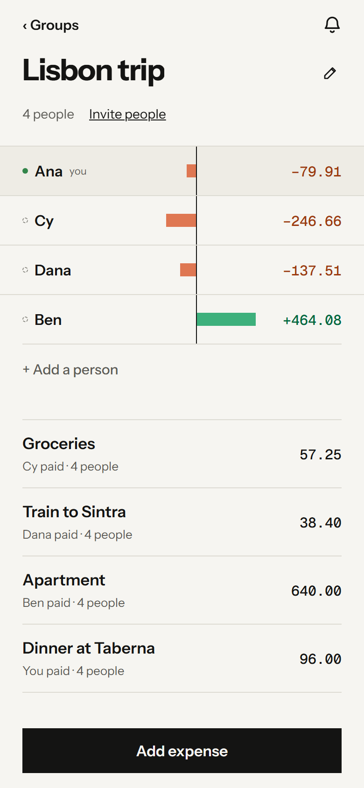
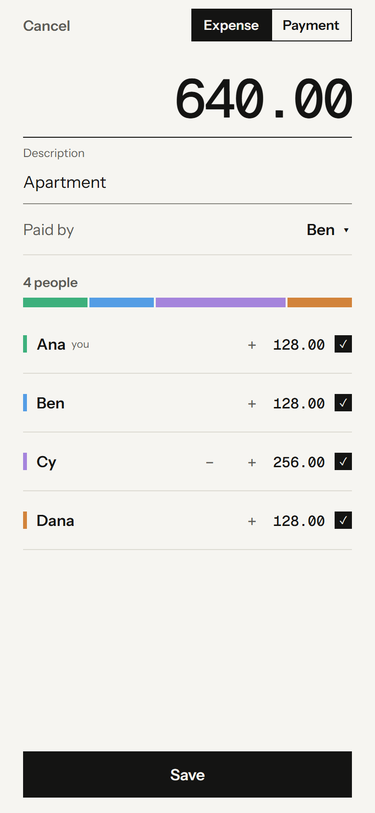
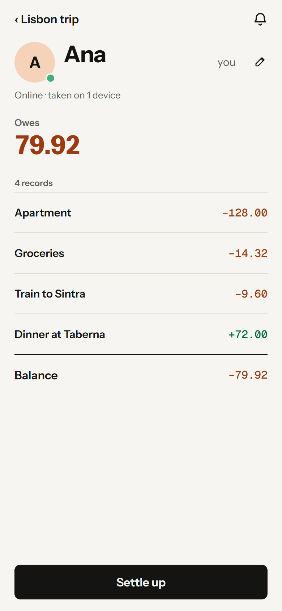
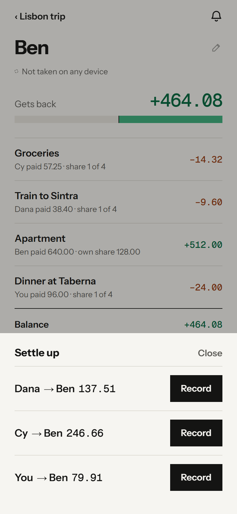

# Splitnext MVP

Splitnext is an offline-first group ledger foundation built on Cloudflare
Workers, D1, and one SQLite Durable Object per group. The current MVP handles
groups, invite links, ledger members, expenses, repayments, Activity and safe undo with
offline synchronization and realtime revision announcements.

<p>
  
  
  
  
</p>

How it fits together, and the rules each part keeps, is in
[docs/architecture.md](./docs/architecture.md).

## What works

- Anonymous per-installation identities and device credentials backed by D1;
  there is no sign-in or account linking.
- Retry-safe group creation with a client-generated group id and an immediately
  usable invite, created atomically by the API.
- Joining through a reusable invite link with a preview of the group, then
  choosing an existing member or joining as someone new.
- Exactly one current invite link per group with no time limit and
  regeneration. Every participant can share the same current link.
  Regeneration invalidates the previous link.
- Offline-capable group rename and member add, rename, remove, and restore
  commands.
- Offline-capable expense record, edit, remove, and restore commands, as
  plain numbers without currency, with allocations and burden-fair rounding
  fixed by the server.
- Explicit repayments with a settle-up plan of the fewest payments,
  partial or excess amounts, offline recording and versioned
  edit/remove/restore commands.
- Cached, attributed Activity and safe compensating undo, including reversing a
  reversal while preserving immutable history and later changes.
- An Activity count in the group header for new changes from other
  identities and changes waiting for review, with new entries marked in
  Activity and Mark all seen.
- Renaming a group in place from its header, and leaving it on this device
  from its row in the groups list.
- Nonexclusive preferred-member selection (the member the UI calls “you”).
- Leaving and rejoining a group without revoking its permanent access grant.
- A per-identity list of accessible groups, marking the ones it left, backed
  by a derived D1 index and cached by the SDK for offline use. The server index
  can restore the list when an installation still has its device credential
  but has lost its local group cache.
- Ordered, idempotent outboxes and full revisioned server snapshots.
- Rejected or superseded command notices stored by the client.
- Realtime revision announcements over hibernatable WebSockets, with automatic
  background synchronization, reconnection, and catch-up in the SDK.
- A stateful TypeScript client SDK with swappable local storage adapters.
- A server group engine with Durable Object and in-memory repository adapters.
- A responsive Expo web app at `/app`, with a public homepage and invite entry
  pages rendered by the same Cloudflare Worker: single-screen group creation,
  member management, invitation sharing, joining and rejoining, group
  switching, expense entry and editing with per-person share controls and fixed
  amounts mixed with weighted shares, balances, and offline command and conflict feedback. Its
  screens are
  described in [docs/architecture.md](./docs/architecture.md#the-web-app) and
  specified in [docs/product-spec.md](./docs/product-spec.md).
- One group screen with everyone's balance as ruled rows above the expenses
  and repayments; person details with a balance breakdown, Settle up, rename,
  and remove; and browser Back/Forward support. Forms return to where
  they were opened.
- A `/components` workbench and in-app devtools, enabled with debug
  inspection, for previewing components and calling any app action.
- One fixed light theme on warm paper with square black controls, locally
  served Instrument Sans and Geist Mono fonts, and morphing screen changes on
  the web. Theme assets are precached with the app shell
  for offline reloads; changing a theme asset invalidates that cache.
- Amounts are plain numbers with two decimals, never shown with a currency,
  and shown with their digits grouped in threes, such as 1 234.50.
  Expenses and repayments record the no-currency code XXX, and the ledger keeps
  any older real-currency records separate; see
  [ADR 0025](./docs/adr/0025-deal-in-plain-numbers-without-currency.md).
- Expenses use the pure, property-tested money module, `src/domain/money.ts`:
  whole minor units per currency, allocation by
  exact amounts and shares, rounding extras that rotate by accumulated burden,
  and balances that net to zero per currency; see
  [ADR 0017](./docs/adr/0017-allocate-money-in-whole-minor-units-with-burden-fair-rounding.md).

Repayments, cached Activity, safe undo and the Activity count are
implemented. Their agreed behavior is in
[the product specification](./docs/product-spec.md#agreed-feature-port-from-the-earlier-app).

Only the web build of the app exists so far. The Expo app has native
variants of a few components, but no native build has been made, its storage
would need a SQLite adapter at the SDK's storage seam, and nothing tests it:
every app test drives the shared model or the web build.

## Quickstart

```bash
npm install
npm run dev
```

`npm install` also points git at the tracked hooks in `.githooks/`. The
development command applies pending migrations to the local D1 database,
exports the Expo web client, and starts the API and server-rendered entry
pages on port 8787 with debug inspection on. It refuses to start while
something already listens on 8787, since a second server in one checkout
leaves both unresponsive.

- `http://localhost:8787/` is the homepage and `/app` the app.
- `/app?devtools` opens the in-app development panel; `/components` the
  component workbench.
- For fast UI iteration, keep that Worker running and run `npm run app:dev` in
  a second terminal; Expo serves on port 8081 against the API on port 8787, and
  reloads SDK edits in `src/` without a restart.
- To try several devices by hand, open `/app` in separate browser profiles or
  a private window; tabs in one profile share an installation.

Remote deployment has not been performed. `wrangler.jsonc` still contains a
placeholder D1 database id.

## Checks

```bash
npm run check
```

runs everything: text encoding, the app build, generated Worker types, lint,
both TypeScript projects, a deploy dry run, the Worker tests, and the browser
tests. The Worker tests load the bundle the dry run writes to
`.wrangler/dry-run`, so run `npm test` on its own only after a check or a dry
run.

`npm run check:fast` runs everything except the app build and the browser
tests, against the last app build, in about a minute. The pre-push hook runs
it; when Git for Windows pushes a checkout inside WSL, the hook runs the checks
inside that distribution. Skip it once with `git push --no-verify`.
`.github/workflows/check.yml` runs the full `npm run check` on a fresh checkout
for every push to `main` or `master` and every pull request, and keeps
Playwright traces when it fails.

`npm run test:e2e` drives the built app in headless Chromium. It starts its
own Worker on port 8791 with separate local storage in `.wrangler/e2e-state`,
recreated on every run, so it does not touch `npm run dev` data. Install the
browser once with `npx playwright install chromium-headless-shell`; a failure
keeps a trace in `test-results/` that `npx playwright show-trace` opens.

## Showcase

```bash
npm run showcase
```

builds the app and drives it through every flow on a phone-sized screen.
It records a video of each flow, with steps and thumbnails that jump to each
moment, then writes `showcase/out/index.html` to open in a browser. Its
Conditional UI section spotlights every element that appears only in some
situation, such as an empty state, an offline or failure message, a conflict
to review, or a missing browser capability, forcing each one with offline
mode, failed or slowed requests, a second device, or a shifted clock. Like the
browser tests, it starts its own Worker, on port 8793, with fresh storage in
`.wrangler/showcase-state`. The flows live in `showcase/capture.spec.ts` and
the conditional cases in `showcase/cases.spec.ts`; a case that can no longer
be reached shows on the page as not captured, with the reason.
`npm run showcase:page` rebuilds only the page from the last capture. The
output is not committed.

## How it is tested

The [device lab](./docs/agents/device-lab.md) runs real independent installations
against a dedicated local Worker. Start it with `npm run lab -- --env=NAME` after
building the frontend; `npm run lab:cli -- discover` publishes the common operation
schemas used by its frontend and AI callers. It retains isolated profiles, steps
and diagnostics under `.wrangler/lab/`. Devices are real headless browsers (`kind: "browser"`)
or many live app instances, each in its own frame of the lab page (`kind: "inpage"`); the guide says when
to use each. See the guide before controlling stores.

| What | Where | What it guarantees |
| --- | --- | --- |
| Command rules | `test/groupCommandRules.test.ts` | The outcome of every rule of every command, as a table. |
| Money | `test/money.test.ts` | Allocation and balances net to zero and round fairly, for generated inputs. |
| Server and HTTP | `test/groups.test.ts`, `join.test.ts`, `sync.test.ts`, `realtime.test.ts`, `transportContract.test.ts`, and others | Routes, persistence, and the contract both transports share. |
| Offline synchronization | `test/syncConvergence.test.ts` | Generated devices, tabs, and groups with lost requests, failed storage, and races converge on the server, with one outcome per command. |
| Client storage | `test/storageBudget.test.ts` | The installation document's size, round trips, and speed stay within budget. |
| App actions | `test/appActions.test.ts`, `test/actionModel.test.ts` | The rules of each action, and for generated sequences, including double clicks, that dispatch agrees with availability and the app always settles. |
| Diagnostics | `test/requestLog.test.ts`, `test/diagnostics.test.ts` | Request ids join client reports to Worker logs, without names or secrets. |
| Browser | `e2e/app.spec.ts` | Rendering, focus, history, realtime between two devices, and offline edits in the built app. |

A generated test that fails prints the shortest failing sequence of steps; keep
it in that test's examples once fixed.

## Diagnosing a problem

In development, **Copy diagnostics** in devtools' Actions tab copies
a report of the app's recent actions and requests with their ids, without
names, links, or inputs. Every request's id is also in the Worker's log line
for it, which records what the server decided. In development, devtools show
the same log live, and `GET /debug/groups/{groupId}` reads a group's server
state. See [docs/architecture.md](./docs/architecture.md#diagnostics).

## Project documentation

- [Architecture](./docs/architecture.md)
- [Domain language](./CONTEXT.md)
- [Accepted product behavior](./docs/product-spec.md)
- [Architecture decisions](./docs/adr/)
- [Agent working agreement](./AGENTS.md)
- [Support playbook](./docs/support-playbook.md)

The groups list shows your balance. Settle up suggests net transfers and records partial or excess repayments, including offline. Repayments represent money paid outside the app.
