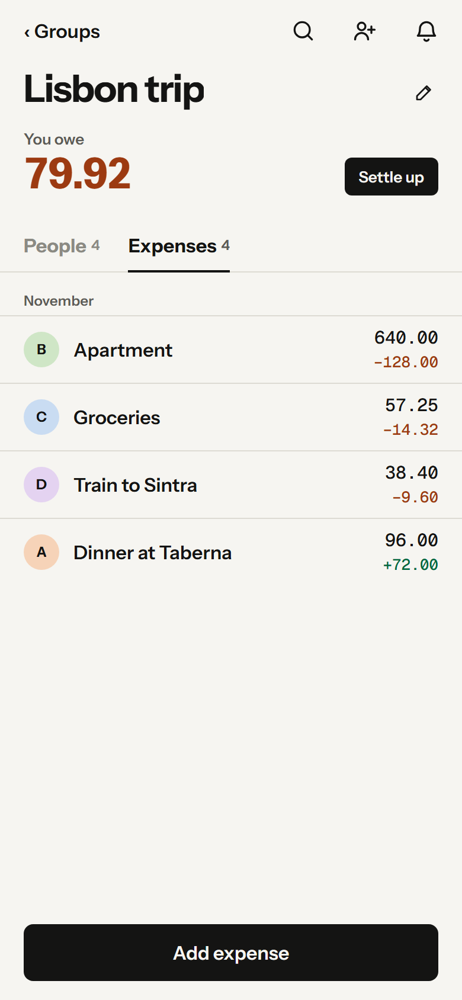

# Splitnext

An offline-first app for sharing expenses with a group. See who owes what, split equally, by shares or by exact amounts, and record repayments. Changes apply at once, stay on the device while offline, and sync when connected. Activity keeps the history, with safe undo.

[Try the staging app](https://splitnext-api-staging.santistebanc94.workers.dev/app). Expo (React Native, web build) on Cloudflare Workers, D1 and one SQLite Durable Object per group.

<p>
  
  
  
  
  
</p>

## Features

- **No accounts:** an anonymous identity per installation; join through one reusable invite link per group (regenerating it invalidates the old one).
- **Offline everything:** group, member, expense and repayment commands queue in an ordered, idempotent outbox and sync in the background over realtime WebSockets. Rejected or superseded commands become notices to review.
- **Fair money:** plain two-decimal numbers with no currency ([ADR 0025](./docs/adr/0025-deal-in-plain-numbers-without-currency.md)); whole minor units with burden-fair rounding in `src/domain/money.ts` ([ADR 0017](./docs/adr/0017-allocate-money-in-whole-minor-units-with-burden-fair-rounding.md)); mixed fixed amounts and weighted shares.
- **Settle up** with the fewest payments; partial or excess repayments.
- **Activity** with attributed history, safe compensating undo (even of an undo), and a count of new changes.
- **One group screen:** where you stand first, People and Expenses tabs, person details with a balance breakdown. A design system in `apps/client/src/design/`, a `/components` catalog and in-app devtools.

Only the web build exists. A native build would need a SQLite storage adapter at the SDK seam, and nothing tests native today. Agreed behavior is in the [product spec](./docs/product-spec.md).

## Run

```bash
npm install     # also enables the tracked .githooks/
npm run dev     # migrations, web export, Worker on :8787 with debug inspection
```

- `http://localhost:8787/` homepage, `/app` the app, `/app?devtools` the dev panel, `/components` the catalog.
- Fast UI loop: keep `dev` running and run `npm run app:dev` (Expo on :8081 against :8787).
- Several devices by hand: separate browser profiles or a private window (tabs in one profile share an installation).
- `dev` refuses to start if something already listens on :8787.

## Check

| Command | What it runs |
|---|---|
| `npm run check` | Everything: encoding, app build, Worker types, lint, both TS projects, deploy dry run, Worker tests, browser tests |
| `npm run check:fast` | All but the app build and browser tests (pre-push hook; skip once with `--no-verify`) |
| `npm run check:steady` / `check:timing` | Without / only the time-measuring tests (storage budget, `@timing` browser tests) |
| `npm run test:e2e` | Built app in headless Chromium on :8791 with fresh `.wrangler/e2e-state` |
| `npm run verify -- help` | Verification entry point; see the [feature map](verification/features.json) and the [verification skill](.agents/skills/verify-splitnext/SKILL.md) |
| `npm run showcase` | Video of every flow plus forced conditional states, written to `showcase/out/index.html` (port :8793, not committed) |

`npm test` alone loads the bundle from `.wrangler/dry-run`, so run it after a check or dry run. Tag a browser test `@timing` when it counts frames. CI (`.github/workflows/check.yml`) runs the same checks on every push to `main`/`master` and every PR.

Only `.wrangler/verification/public/` holds publishable evidence. Logs, traces, credentials and failure messages stay in `.wrangler/verification/private/` and are never uploaded.

The [device lab](./docs/agents/device-lab.md) runs real independent installations against a local Worker (`npm run lab -- --env=NAME`). A failing generated test prints the shortest failing sequence; keep it as an example once fixed.

## Staging

`npm run deploy:staging` (clean checkout, Cloudflare credentials) builds, migrates the staging D1 and deploys. `/health` reports the deployed revision; `/ready` checks D1 and the Durable Object. Production in `wrangler.jsonc` still has a placeholder D1 id and is not deployed.

## Diagnose

Devtools → Actions → **Copy diagnostics** copies recent actions and request ids without names, links or inputs. Each id is in the Worker's log line for that request. In development `GET /debug/groups/{groupId}` reads a group's server state. See [architecture: diagnostics](./docs/architecture.md#diagnostics).

## Docs

[Architecture](./docs/architecture.md) · [Domain language](./CONTEXT.md) · [Product spec](./docs/product-spec.md) · [ADRs](./docs/adr/) · [Agent agreement](./AGENTS.md) · [Operations](./docs/operations.md) · [Support playbook](./docs/support-playbook.md)
