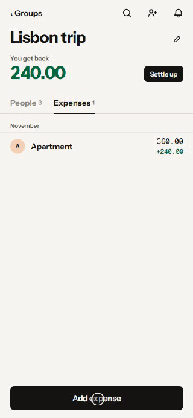
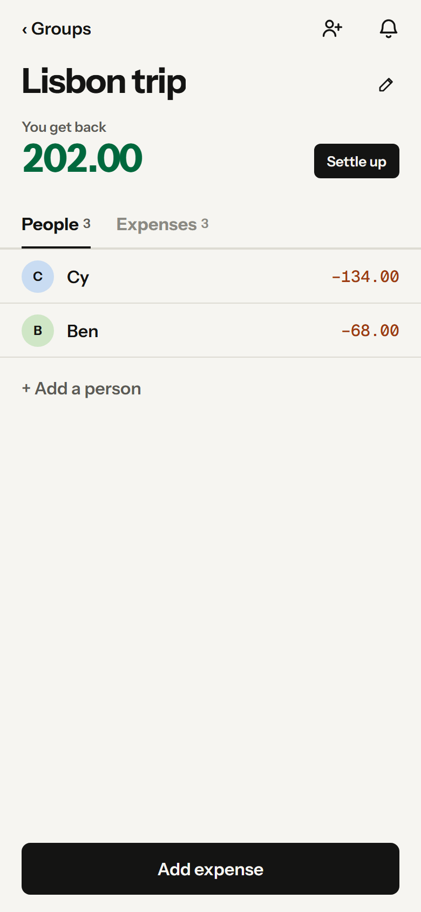
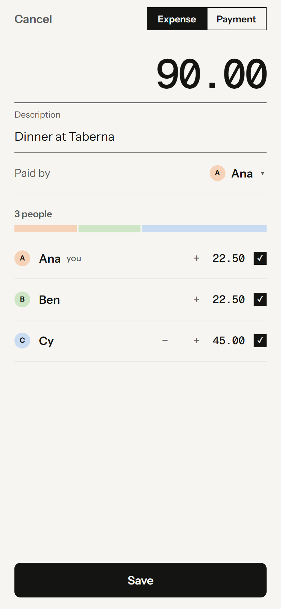
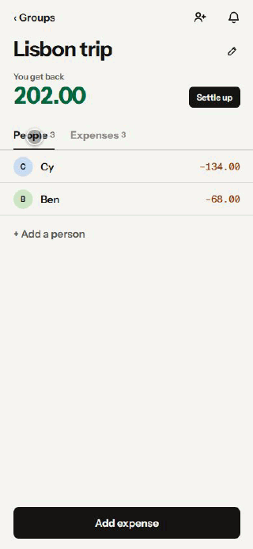

# Splitnext

Splitnext shares expenses within a group: who owes what, uneven splits and repayments, offline on every device.

**[Open Splitnext (staging)](https://splitnext-api-staging.santistebanc94.workers.dev/app)** · [Docs](docs/)



## Features

<table>
<tr>
<td width="50%"></td>
<td><b>Balances first</b><br>A group opens on what each person owes or gets back.</td>
</tr>
<tr>
<td width="50%"></td>
<td><b>Any split</b><br>Split equally, by shares or by exact amounts; rounding stays fair.</td>
</tr>
<tr>
<td width="50%"></td>
<td><b>Settle up</b><br>A plan with the fewest payments; record a repayment with one press.</td>
</tr>
</table>

Changes apply at once, wait on the device while offline and sync when connected. Groups join through one reusable invite link. Activity keeps the history, with safe undo. There is no sign-in: each installation has its own identity. The full list is in [What works](docs/features.md).

## Quick start

```sh
git clone https://github.com/santistebanc/splitnext.git
cd splitnext
npm install
npm run dev   # → http://localhost:8787/app
```

`npm run dev` applies local D1 migrations, exports the Expo web client and starts the Worker. It refuses to start when port 8787 is taken.

## How it's built

- **Client:** one Expo Router app (React Native) in `apps/client`, exported for the web today.
- **Sync:** a TypeScript client SDK with an offline outbox of commands, full revisioned snapshots and realtime announcements over WebSockets.
- **Server:** Cloudflare Workers, D1 for identities and group lists, and one SQLite Durable Object per group.
- **Money:** allocations in whole minor units with burden-fair rounding, decided by the server.
- **Decisions:** each design choice is an [architecture decision record](docs/adr/).

## More

- [What works](docs/features.md): every feature of the app and the SDK.
- [Development, checks and testing](docs/development.md): dev servers, staging, checks, the showcase walkthrough, the device lab and diagnostics.
- [Architecture](docs/architecture.md), [domain language](CONTEXT.md), [product spec](docs/product-spec.md), [operations](docs/operations.md) and [support playbook](docs/support-playbook.md).
- [Agent working agreement](AGENTS.md).
- [Media and capture config](docs/media/), refreshed with the project-showcase capture script.
